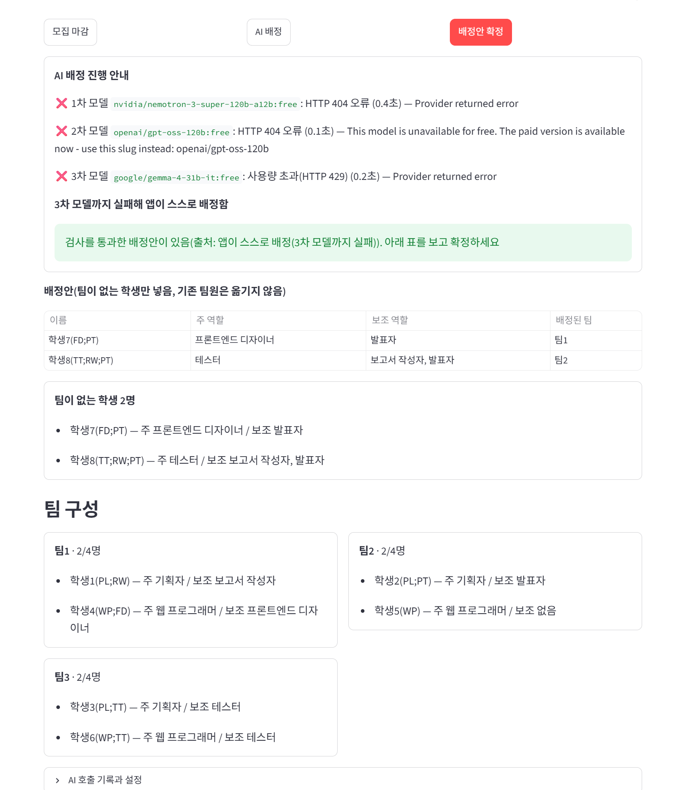
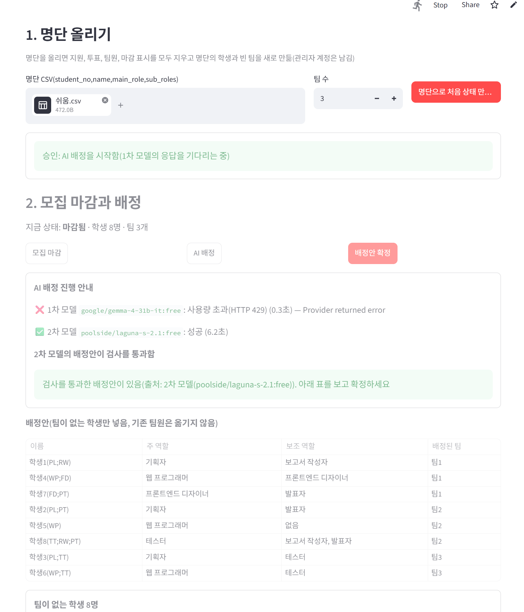

# 팀 프로젝트 팀 편성 앱

## 1. 배포 주소
https://team-forming-grre2zgjfmp9krrgegyjvk.streamlit.app/

## 2. PRD와 구현 계획의 위치
- `docs/PRD.md`
- `docs/구현 계획.md`

## 3. 고른 해결 방법
| 기능 | 고른 해결 | 구현 |
|---|---|---|
| 다른 사람의 변경 보기 | 어려운 해결 | `st.fragment(run_every=3)` 로 학생·관리자 화면의 바뀐 부분만 3초마다 다시 그림 |
| 필수 포함 역할을 지킬 수 없는 팀 | 어려운 해결 | 지원할 때 "들어간 뒤 남는 자리 < 채우지 못한 필수 포함 역할 수"면 막음(`tf/rules.py` `join_problem`) |
| 같은 팀에 대기 중인 지원이 여럿 | 어려운 해결 | 모든 팀원이 찬성한 순간 규칙을 다시 검사(투표가 끝난 순서로 처리) |
| 마지막 자리에 두 명이 동시에 들어감 | 어려운 해결 | `tf_members` 의 `(team_id, slot_no)` 기본 키와 `student_id` 유일성 제약(`schema.sql`) |
| AI 응답이 늦을 때 | 어려운 해결 | 모델마다 부른 때부터 전체 120초를 재서 끊고 다음 모델로(`tf/ai.py` `call_model`) |
| 3차 모델까지 실패 | 어려운 해결 | 검사 다섯 가지를 모두 통과하는 배정을 모든 경우를 따져 찾음(`tf/rules.py` `solve`) |
| AI 대기 중 화면 | 어려운 해결 | "2차 모델(…)의 응답을 기다리는 중 · 35초 지남"처럼 차수와 경과 시간을 보여 줌 |
| DB 일시정지 막기 | 어려운 해결 | GitHub Actions 예약 작업이 매일 09:17(한국 시각)에 DB에 질의(`.github/workflows/keepalive.yml`) |

## 4. 쓴 모델 3개
- 1차 `google/gemma-4-31b-it:free`
- 2차 `poolside/laguna-s-2.1:free`
- 3차 `nvidia/nemotron-3-super-120b-a12b:free`

처음에는 1차 `nvidia/nemotron-3-super-120b-a12b:free`, 2차 `openai/gpt-oss-120b:free`, 3차 `google/gemma-4-31b-it:free` 를 썼으나, 10/26 쉬움 시나리오에서 세 모델이 모두 실패해(404, 무료 중단, 429) 위 모델로 바꿈.

## 5. 오픈라우터 AI 모델 호출 실패 사례
**사례 1: 세 모델이 모두 실패해 앱이 스스로 배정함** (10/26, 연습용 쉬움 시나리오 6단계)
- 1차 `nvidia/nemotron-3-super-120b-a12b:free`: HTTP 404(Provider returned error)
- 2차 `openai/gpt-oss-120b:free`: HTTP 404(무료 버전이 없어지고 유료 버전만 남았다는 응답)
- 3차 `google/gemma-4-31b-it:free`: 사용량 초과(HTTP 429)
- 3차까지 실패해 앱이 모든 경우를 따져 배정함(학생7 → 팀1, 학생8 → 팀2). 배정안은 검사 다섯 가지를 통과했고 확정할 수 있었음
- 화면: `img/ai-all-failed.png`

**사례 2: 1차 모델이 429로 실패해 2차 모델로 넘어감** (10/26, 모델을 바꾼 뒤 쉬움 명단으로 지원 없이 마감하고 8명 모두 AI 배정)
- 1차 `google/gemma-4-31b-it:free`: 사용량 초과(HTTP 429, 0.3초)
- 2차 `poolside/laguna-s-2.1:free`: 6.2초 만에 성공. 배정안이 검사 다섯 가지를 통과해 관리자 화면에 보임(세 팀 모두 기획자와 웹 프로그래머가 있고 주 역할 겹침 없음)
- 화면: `img/ai-429-then-2nd.png`




## 6. 클로드가 잘못된 추론이나 답변을 한 사례
**클로드가 고른 무료 모델 3개가 이미 쓸 수 없는 모델이었음**
- 클로드가 처음 코드를 만들 때, 6월 기준 정보로 1차 `nvidia/nemotron-3-super-120b-a12b:free`, 2차 `openai/gpt-oss-120b:free`, 3차 `google/gemma-4-31b-it:free` 를 기본 모델로 정함
- 배포한 앱으로 연습용 쉬움 시나리오 6단계(AI 배정)를 해 보니 세 모델이 모두 실패함. 특히 2차 모델은 "무료 버전이 없어짐"이라는 응답이 와서, 클로드가 고른 모델 목록이 지금과 맞지 않는다는 것을 알아챔(화면 `img/ai-all-failed.png`)
- 클로드에게 알려 10월 기준 무료 모델 목록을 다시 찾게 하고, 커밋 `5639e40`에서 모델을 바꿈. 바꾼 뒤 다시 AI 배정을 해서 2차 모델이 성공하는 것을 확인함(화면 `img/ai-429-then-2nd.png`)

## 7. 제출한 앱의 문제점이나 개선 필요 사항
**문제 1: 찬성을 누른 투표가 기록되지 않아 팀 구성이 기대와 달라짐** (10/26, 연습용 쉬움 시나리오 첫 시도)
- 2단계에서 학생4가 팀1에 지원(대기)했고, 학생1 화면에 학생4의 찬성·거부 단추가 자동으로 나타남(화면 `img/easy-step2-before-vote.png`). 학생1로 찬성을 눌렀으나 학생4가 승인되지 않고 대기로 남음
- 그 때문에 4단계에서 팀1의 팀원이 학생1뿐이어서 학생7이 학생1의 찬성 하나로 승인되었고, 그 뒤 학생7이 팀원으로서 학생4의 지원에 거부를 눌러 학생4가 거절됨. 결과적으로 팀1이 학생1, 학생7이 됨(기대: 학생1, 학생4)(화면 `img/easy-wrong-team1.png`, `img/easy-student4-rejected.png`)
- 처음 상태로 되돌려 다시 해 보니 같은 단계에서 정상으로 승인되어 다시 만들지 못함. 화면이 3초마다 다시 그려지는 순간에 단추를 눌러 클릭이 전달되지 않았는지, 단추를 누르지 못했는지는 확인하지 못함(DB의 `tf_votes` 를 확인하지 않음)
- 개선할 점: 투표를 누른 뒤 결과 안내가 바뀌었는지 사용자가 확인하기 어려움. 단추를 누른 순간 결과 안내를 바로 지우거나 "처리 중"을 보여 주고, 다시 그리는 중에 누른 클릭이 사라지지 않는지 시험해야 함

**문제 2: 결과 안내가 다른 사람의 동작으로 바뀐 상태를 반영하지 않음**
- 학생4가 지원한 뒤 결과 안내에 "대기"가 나왔고, 학생1이 찬성해 학생4가 팀1의 팀원이 된 뒤에도 학생4 화면의 결과 안내는 계속 "대기: 팀1 팀원 1명의 투표를 기다림"으로 남음. 바로 아래 "내 팀: 팀1"과 "내 마지막 지원: 승인"은 바르게 바뀌어 화면 안에서 서로 다른 말을 함(화면 `img/stale-result.png`)
- 공고의 규칙(결과 안내는 단추를 누른 사람에게 그 동작의 결과를 보여 줌)에는 맞지만 헷갈림. 내 지원의 상태가 바뀌면 결과 안내 옆에 "지금 상태: 승인"을 함께 보여 주면 나아짐

**문제 3: 3초마다 화면 전체가 잠깐 흐려짐**
- 자동 갱신(`st.fragment`)으로 다시 그리는 동안 화면이 잠깐 흐려져, 그 순간 찍은 화면은 글자가 흐리게 나옴. 갱신 간격을 늘리면 덜하지만 공고의 5초 제한 안에서만 늘릴 수 있음

---

## 실행 방법

### 로컬
1. 파이썬 3.11 이상에서 `pip install -r requirements.txt`
2. `.env.example` 을 복사해 이름을 정확히 `.env` 로 바꾸고 값을 채움(두 번 눌러 열지 말 것)
   - `DATABASE_URL`: Supabase 대시보드 > Connect > **Transaction pooler** 주소(포트 6543). `[YOUR-PASSWORD]` 를 DB 비밀번호로 바꿈
   - `OPENROUTER_API_KEY`: 오픈라우터 키
   - `ADMIN_PASSWORD`: 관리자 비밀번호(e-class 제출 칸에만 적음)
3. `streamlit run streamlit_app.py`
4. 처음 실행하면 `schema.sql` 이 실행되어 `tf_` 테이블이 만들어짐(이미 있으면 그대로 둠)

### 배포(Streamlit Community Cloud)
1. 깃허브 비공개 저장소에 올림(`.env` 가 올라가지 않았는지 확인)
2. Streamlit Workspace settings > Linked accounts > Private access 옆 "Connect here"
3. Create app: Branch `main`(또는 `master`), Main file path `streamlit_app.py`
4. Advanced settings > Secrets에 `.env` 와 같은 이름으로 넣음
   ```
   OPENROUTER_API_KEY = "sk-or-v1-..."
   DATABASE_URL = "postgresql://..."
   ADMIN_PASSWORD = "..."
   ```
5. 배포 뒤 Settings > Sharing > "This app is public and searchable" > Save changes
6. 시크릿 창으로 배포 주소를 열어 로그인 화면이 보이는지 확인

### DB 일시정지 막기
저장소 Settings > Secrets and variables > Actions > New repository secret 에 `DATABASE_URL` 을 넣음. Actions 탭 > "DB 일시정지 막기" > Run workflow 로 한 번 실행해 성공하는지 확인. 그 뒤로 매일 자동으로 실행됨.

### 시험
로컬 PostgreSQL 이 있으면 다음으로 연습용 시나리오를 단계마다 확인할 수 있음(시험용 DB를 지우고 다시 만드니 Supabase 주소로는 돌리지 말 것).
```
TF_TEST_PSQL="-h localhost -U postgres -d tftest" TF_CSV_DIR=(CSV 폴더) python tests/test_scenarios.py
python tests/test_rules.py
```

### 제출용 압축 파일
커밋한 파일만 압축함(숨은 파일 `.env` 가 들어가지 않게): `git archive -o 학번.zip HEAD` 뒤 `unzip -l 학번.zip` 으로 `.env` 가 없는지 확인.
